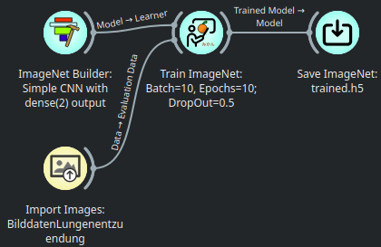
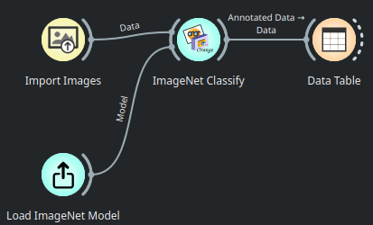
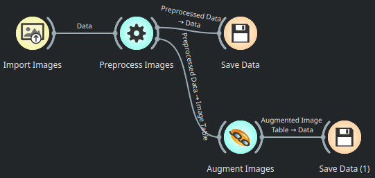

Welcome to Orange3 ImageNets documentation!
===========================================

Widgets for building, training and applying neural networks to images in `Orange <https://orangedatamining.com>`_.

Install the add-on from Orange's *Add-ons* dialog (search for ``orange3-imagenets``) or with ``pip install orange3-imagenets``.
The widgets read image tables produced by the *Import Images* widget of the Image Analytics add-on.

Typical workflows
-----------------

*Train:* Import Images, Build ImageNet, Train ImageNet, Save ImageNet.

*Classify:* Import Images and Load ImageNet, then Classify Images.

*Prepare data:* Import Images, Preprocess Images, Augment Images.

Widgets
-------

.. toctree::
   :maxdepth: 1

   widgets/build-imagenet
   widgets/train-imagenet
   widgets/save-imagenet
   widgets/load-imagenet
   widgets/classify-images
   widgets/preprocess-images
   widgets/augment-images

Indices and tables
==================

* :ref:`genindex`
* :ref:`search`
