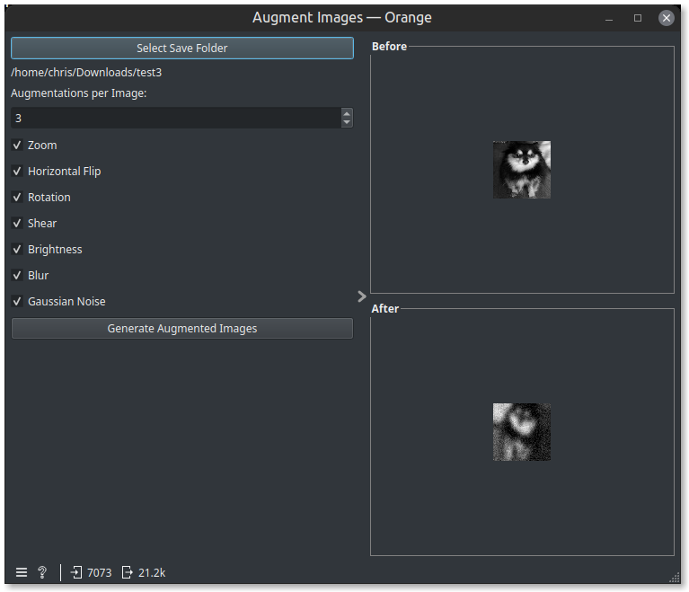

# Augment Images

Create extra training images by random transformations.

**Inputs**

- Image Table: an image table

**Outputs**

- Augmented Image Table: the original and generated images

**Settings**

- **Augment count**: new images per original (default 2).
- Transformations: zoom, flip, rotate, shear, brightness, blur and Gaussian noise.
- **Save folder**: where the new images are written.
