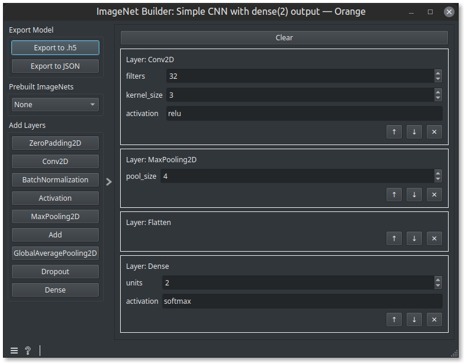

# Build ImageNet

Assemble a Keras `Sequential` model layer by layer.

**Outputs**

- Model: the Keras model, sent again every time a layer is added, moved, deleted or edited

**Using it**

- Pick a **prebuilt ImageNet** (SimpleCNN, LeNet or MiniResNet) as a starting point, or add layers with the buttons in the left panel.
- Each layer is a box with its parameters; use the arrows to reorder it and the cross to delete it. A network keeps at least two layers.
- **Clear** resets the network to a Rescaling layer and a Dense softmax output.
- **Export to .h5** and **Export to JSON** write `custom_model.h5` or `custom_model.json` into the current folder. To choose the location, use [Save ImageNet](save-imagenet.md).

The layer list is stored with the workflow, so it comes back when you reopen it.
