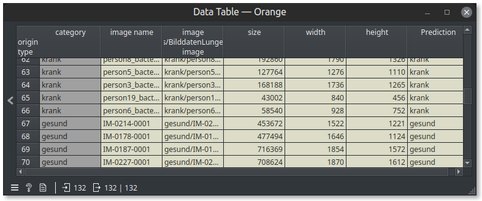

# Classify Images

Predict the class of every image in a table.

**Inputs**

- Data: an image table
- Model: a trained Keras model

**Outputs**

- Annotated Data: the input with a `Prediction` meta column

Images are resized to 224 × 224 and scaled to 0–1 before prediction, so train the model on the same size. Classification starts as soon as both inputs are connected.
