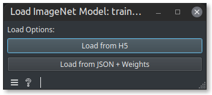

# Load ImageNet

Load a saved model.

**Outputs**

- Model: the loaded Keras model, or a GAN or diffusion model

**Using it**

- **Load from H5** reads a complete model.
- **Load from JSON + Weights** reads the architecture from the chosen `.json` file and the weights from `<name>_weights.h5` in the same folder.
- **Load GAN / diffusion model** reads a `.imagenet` file; connect the output to [Generate Images](generate-images.md).
- The last file is remembered and loaded again when the workflow is reopened.
