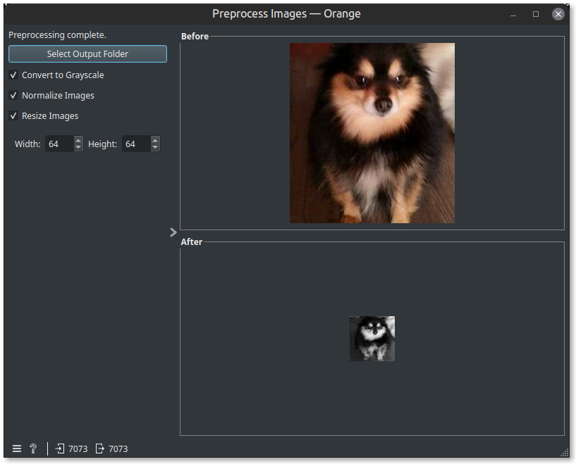

# Preprocess Images

Convert, resize and normalise images and write the results to a folder.

**Inputs**

- Data: an image table

**Outputs**

- Preprocessed Data: the table, now pointing at the preprocessed copies

**Settings**

- **Grayscale**, **Resize** (width and height, default 224 × 224) and **Normalize** (stretch the contrast to 0–255).

The first image is previewed before and after. Choose an output folder to start processing; the subfolder layout is kept.
