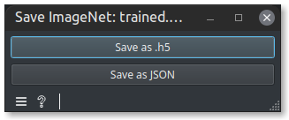

# Save ImageNet

Save a model to disk.

**Inputs**

- Model: a Keras model, or a GAN or diffusion model from [Train GAN](train-gan.md) / [Train Diffusion](train-diffusion.md)

**Using it**

- **Save as .h5** stores the whole model, weights included.
- **Save as JSON** stores only the architecture. Keep the weights in a file named `<name>_weights.h5` next to it so [Load ImageNet](load-imagenet.md) can find them.
- **Save GAN / diffusion model** writes one `.imagenet` file holding the network and its settings (image size, noise steps, class names). The `.h5` and JSON buttons refuse these models.
- The `.h5`, `.json` or `.imagenet` extension is added if you leave it off.
