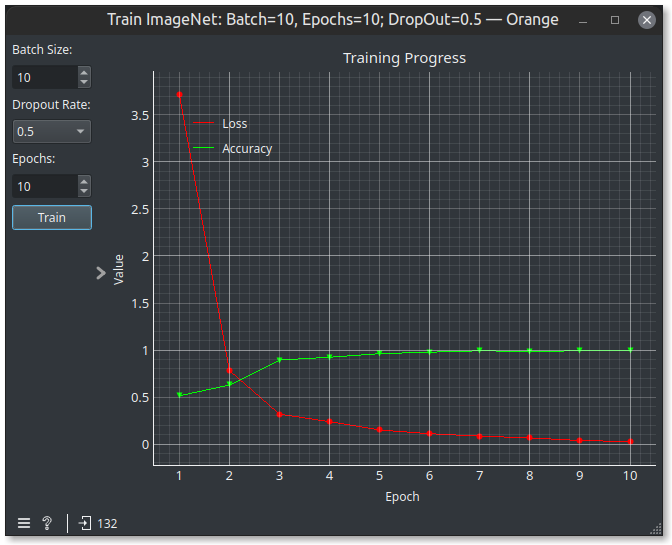

# Train ImageNet

Train a Keras model on an image table and watch its performance.

**Inputs**

- Learner: the model from [Build ImageNet](build-imagenet.md)
- Evaluation Data: an image table with a class variable

**Outputs**

- Trained Model: the model after training

**Settings**

- **Batch size** (default 32), **Epochs** (default 10) and **Dropout rate** (default 0.5).
